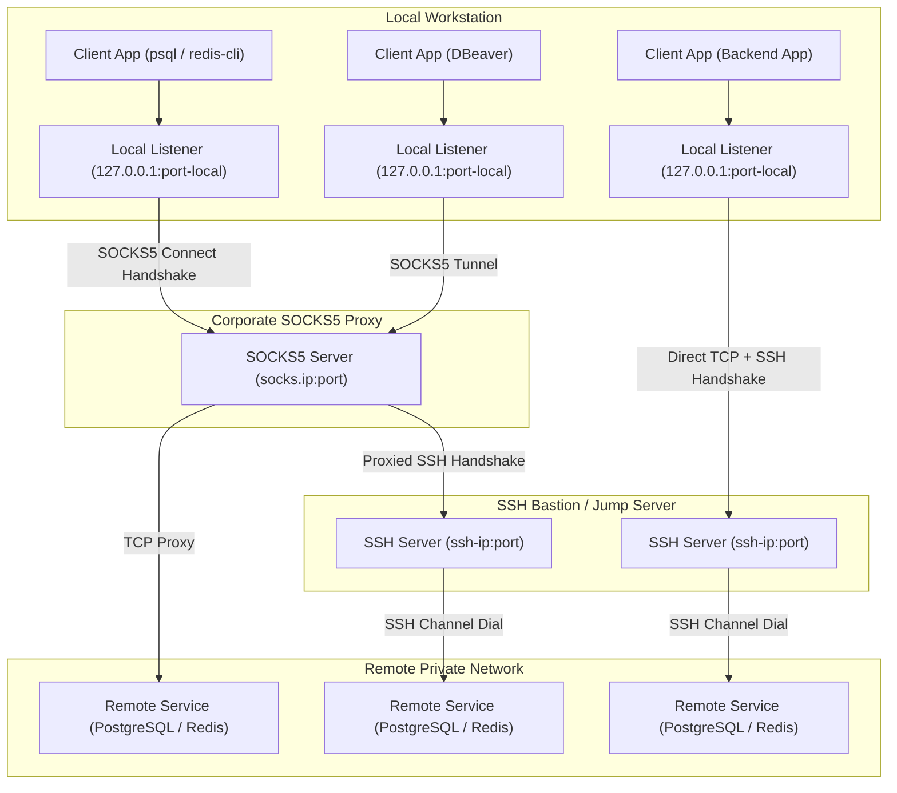
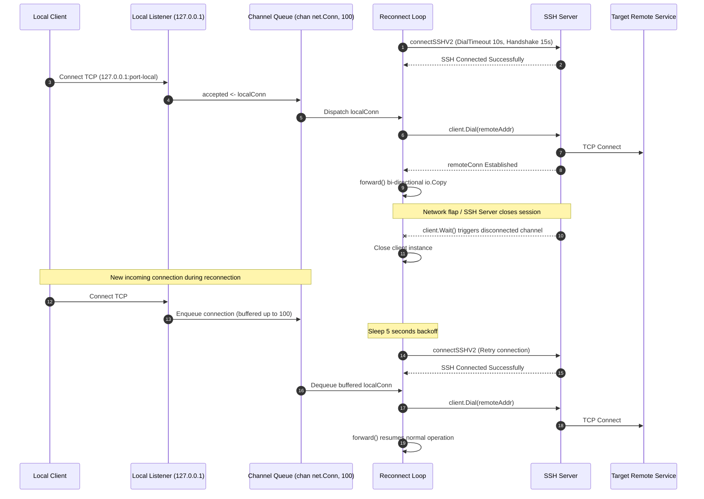

# Forwarded Proxy

A lightweight, concurrent TCP port-forwarding and tunneling tool written in Go. Forwarded Proxy bridges local workstation ports to remote, private network services (such as PostgreSQL and Redis instances) across multi-hop network paths using SOCKS5 proxies, SSH bastion hosts, or direct auto-reconnecting SSH tunnels.

---

## Table of Contents

- [Overview](#overview)
- [Features](#features)
- [Architecture & Forwarding Modes](#architecture--forwarding-modes)
- [Project Structure](#project-structure)
- [Requirements](#requirements)
- [Installation](#installation)
- [Configuration](#configuration)
  - [Configuration File Overview](#configuration-file-overview)
  - [Configuration Parameters](#configuration-parameters)
  - [Example Configuration](#example-configuration)
  - [Target Route Mapping](#target-route-mapping)
- [Usage](#usage)
  - [Running with Go](#running-with-go)
  - [Building an Executable Binary](#building-an-executable-binary)
  - [Connecting to Forwarded Services](#connecting-to-forwarded-services)
- [How It Works](#how-it-works)
  - [Application Lifecycle & Startup](#application-lifecycle--startup)
  - [Traffic Flow Architecture](#traffic-flow-architecture)
  - [SSH Auto-Reconnection & Queueing Flow](#ssh-auto-reconnection--queueing-flow)
- [Error Handling and Logging](#error-handling-and-logging)
- [Troubleshooting](#troubleshooting)
- [Contributing](#contributing)
- [License](#license)

---

## Overview

In modern cloud and enterprise environments, internal infrastructure—such as databases, cache instances, and backend microservices—is routinely isolated within private subnets, staging clusters, or secure VPCs. Direct external access is typically restricted by corporate firewalls, requiring developers to route traffic through intermediary gateways such as SOCKS5 corporate proxies, SSH bastion hosts (jump servers), or chained combinations of both.

**Forwarded Proxy** automates and centralizes these port-forwarding tunnels. Instead of manually maintaining multiple terminal-based SSH sessions (`ssh -L ...`) or custom proxy tunneling utilities, Forwarded Proxy reads a centralized `config.json` file and concurrently establishes local listeners bound to `127.0.0.1`. Client applications on your local machine (database management tools, IDEs, CLI utilities, Redis clients) connect directly to these local ports, and Forwarded Proxy transparently transports the TCP stream to the remote destination.

### Primary Use Cases

- **Local Database & Cache Access**: Connect GUI tools (e.g., DBeaver, pgAdmin, Redis Insight) to isolated staging, sandbox, and production databases.
- **Microservice Development & Testing**: Route local service dependencies to remote backend resources without exposing those resources to the public internet.
- **Multi-Hop Traversal**: Traverse restrictive enterprise networks where SSH hosts can only be reached through an upstream SOCKS5 proxy.
- **Resilient Connections**: Maintain uninterrupted local listeners even when underlying remote SSH connections drop or experience transient network outages.

---

## Features

- **Three Dedicated Transport Modes**:
  - **Direct SOCKS5 Forwarding**: Connects locally, performs a custom SOCKS5 no-auth handshake, and forwards directly to the target host and port via an upstream SOCKS5 proxy.
  - **Chained SOCKS5 + SSH Bastion**: Connects to an upstream SOCKS5 proxy, tunnels through to an SSH bastion host, and proxies TCP traffic from the SSH bastion to internal private targets.
  - **Direct SSH Tunneling with Auto-Reconnect**: Connects directly to an SSH server with password authentication, establishing a persistent local listener with an automatic reconnection loop.
- **Resilient Connection Queueing**:
  Direct SSH tunnels decouple the local TCP listener from the SSH session. Up to 100 incoming connections are held in a buffered channel queue while SSH sessions reconnect, preventing client connection drops during brief network flaps.
- **Automatic Reconnection with Exponential-Style Periodic Backoff**:
  Monitors SSH session lifecycles via `client.Wait()`. If the remote SSH host drops, the supervisor loop automatically attempts to reconnect every 5 seconds without restarting the application or closing local listeners.
- **Target-Level Activation Switches**:
  Each remote service entry features independent `status` (`active` / `in-active`) and `via-socks` (`active` / `in-active`) switches to dynamically control which tunnels are initialized.
- **Staggered Concurrent Startup**:
  Initializes proxy connections concurrently using Go routines with a staggered startup delay (500ms intervals) to avoid port races and socket exhaustion during boot.
- **Colorized Terminal Output & Client Auditing**:
  Features ANSI-colored logs (green for active listeners and discovered client IPs, red for connection failures and state changes).
- **Minimal External Dependencies**:
  Built strictly with Go standard library components and standard Go sub-repositories (`golang.org/x/crypto` and `golang.org/x/net`).

---

## Architecture & Forwarding Modes

The application selects the transport mechanism for each target based on the target configuration and the routines defined in `forwarded.go`:

| Forwarding Mode | Configuration Requirement | Network Path | Handled By Function |
| :--- | :--- | :--- | :--- |
| **Direct SOCKS5** | `status: "active"`, `via-socks: "active"` | `Local Client -> Local Port -> Upstream SOCKS5 Proxy -> Remote Target` | `connectSocks` |
| **Chained SOCKS5 + SSH** | `status: "active"`, `via-socks: "active"` | `Local Client -> Local Port -> Upstream SOCKS5 Proxy -> SSH Bastion -> Remote Target` | `connectSocksSSH` |
| **Direct SSH (Auto-Reconnect)** | `status: "active"`, `via-socks: "in-active"` | `Local Client -> Local Port -> SSH Bastion (Direct TCP) -> Remote Target` | `startTunnel` |

> [!NOTE]
> When `status` is set to `"in-active"`, or if `via-socks` does not match the active condition of the forwarding routine, the routine logs an informational message and skips initializing that tunnel.

---

## Project Structure

```
forwarded-proxy/
├── .gitignore              # Ignores build artifacts (*.exe, /bin/, /dist/), temp files, and local config.json
├── config.json             # Local configuration file containing active targets and credentials (ignored by git)
├── config.json.example     # Template configuration illustrating structure and parameter format
├── forwarded.go            # Complete application source code (listeners, SSH clients, SOCKS dialer, tunnel loops)
├── go.mod                  # Go module definition and required dependency versions (Go 1.26.0)
└── go.sum                  # Cryptographic checksums for external module dependencies
```

### Component Responsibilities

- **`forwarded.go`**: Contains all logic for:
  - Configuration parsing via `initConfig` and dot-path retrieval via `GetConfig`.
  - Custom SOCKS5 protocol handshake implementation (`socks5Dial`).
  - SOCKS-proxied SSH client initialization via `golang.org/x/net/proxy`.
  - Direct SSH client initialization with deadline management (`connectSSHV2`).
  - Channel-buffered connection queuing and auto-reconnecting tunnel loops (`startTunnel`).
  - Bi-directional stream copying (`io.Copy`) between local and remote connections.
- **`config.json.example`**: Sanitized baseline file demonstrating the expected JSON schema, keys, and values for all environments.
- **`config.json`**: The active configuration read at runtime. Contains live endpoints, ports, and credentials.
- **`go.mod` & `go.sum`**: Define module requirements: `golang.org/x/crypto v0.58.0` for SSH protocols and `golang.org/x/net v0.60.0` for SOCKS proxy dialers.

---

## Requirements

- **Go Compiler**: Go **1.26.0** or later (the codebase utilizes the Go 1.26 `sync.WaitGroup.Go` method).
- **Supported Operating Systems**: Windows, Linux, macOS.
- **Network Connectivity**:
  - Direct network reachability to the configured SOCKS5 proxy IP and port (if using SOCKS modes).
  - Direct network reachability to the configured SSH bastion server IP and port (if using direct SSH mode).
  - Valid SSH user credentials (password-based authentication).

---

## Installation

1. **Clone the repository**:
   ```bash
   git clone https://github.com/deoartanta/forwarded-proxy.git
   cd forwarded-proxy
   ```

2. **Download module dependencies**:
   ```bash
   go mod download
   ```

3. **Verify module integrity**:
   ```bash
   go mod verify
   ```

4. **Initialize local configuration**:
   Copy the example configuration template to create your active `config.json`:
   - **Linux / macOS**:
     ```bash
     cp config.json.example config.json
     ```
   - **Windows (PowerShell)**:
     ```powershell
     Copy-Item config.json.example config.json
     ```

---

## Configuration

### Configuration File Overview

The application strictly expects a file named `config.json` to exist in the current working directory where the application is executed. Configuration is split into:
1. `socks`: Global upstream SOCKS5 proxy server details.
2. `remote`: A dictionary of named target configurations (e.g., `stg`, `stg-redis`, `sbox-sdn`, `sbox-cda`, `prod-sdn-redis`, `prod-sdn`).

### Configuration Parameters

#### Global SOCKS Settings (`socks`)

| Parameter | Type | Required | Description |
| :--- | :--- | :--- | :--- |
| `ip` | String | Yes | IP address or hostname of the upstream SOCKS5 proxy server. |
| `port` | Integer | Yes | TCP port number of the upstream SOCKS5 proxy server (e.g., `1080`). |

#### Remote Target Settings (`remote.<target_name>`)

| Parameter | Type | Required | Description |
| :--- | :--- | :--- | :--- |
| `ip` | String | Yes | Destination IP address of the target service inside the private network. |
| `port` | Integer | Yes | Destination port of the target service inside the private network (e.g., `5432` for PostgreSQL, `6379` for Redis). |
| `port-local` | Integer | Yes | Local TCP port to bind on `127.0.0.1` on your local workstation. |
| `ssh-ip` | String | Yes | IP address of the intermediate SSH bastion / jump host. |
| `ssh-port` | String | Yes | Port number of the SSH bastion (e.g., `"22"`). |
| `ssh-user` | String | Yes | SSH username for authentication on the bastion server. |
| `ssh-password` | String | Yes | SSH password for authentication on the bastion server. |
| `via-socks` | String | Yes | Routing mode switch. Set to `"active"` to route traffic through the SOCKS5 proxy, or `"in-active"` to route directly to the SSH bastion. |
| `status` | String | Yes | Target state switch. Set to `"active"` to enable this tunnel, or `"in-active"` to disable it. |

### Example Configuration

Below is a sanitized configuration example matching the structure of `config.json.example`:

```json
{
    "socks": {
        "ip": "192.168.4.81",
        "port": 1080
    },
    "remote": {
        "stg": {
            "ip": "10.0.1.50",
            "ssh-ip": "198.51.100.10",
            "ssh-port": "22",
            "ssh-user": "tunneluser",
            "ssh-password": "SecurePassword123!",
            "port": 5432,
            "port-local": 9101,
            "via-socks": "in-active",
            "status": "active"
        },
        "stg-redis": {
            "ip": "10.0.1.51",
            "ssh-ip": "198.51.100.10",
            "ssh-port": "22",
            "ssh-user": "tunneluser",
            "ssh-password": "SecurePassword123!",
            "port": 6379,
            "port-local": 9102,
            "via-socks": "active",
            "status": "active"
        },
        "sbox-sdn": {
            "ip": "10.0.2.10",
            "ssh-ip": "198.51.100.20",
            "ssh-port": "22",
            "ssh-user": "tunneluser",
            "ssh-password": "SecurePassword123!",
            "port": 5432,
            "port-local": 9201,
            "via-socks": "active",
            "status": "active"
        },
        "sbox-cda": {
            "ip": "10.0.2.20",
            "ssh-ip": "198.51.100.20",
            "ssh-port": "22",
            "ssh-user": "tunneluser",
            "ssh-password": "SecurePassword123!",
            "port": 5432,
            "port-local": 9202,
            "via-socks": "in-active",
            "status": "active"
        },
        "prod-sdn-redis": {
            "ip": "10.0.3.10",
            "ssh-ip": "198.51.100.30",
            "ssh-port": "22",
            "ssh-user": "tunneluser",
            "ssh-password": "SecurePassword123!",
            "port": 6379,
            "port-local": 9301,
            "via-socks": "in-active",
            "status": "in-active"
        },
        "prod-sdn": {
            "ip": "10.0.3.20",
            "ssh-ip": "198.51.100.30",
            "ssh-port": "22",
            "ssh-user": "tunneluser",
            "ssh-password": "SecurePassword123!",
            "port": 5432,
            "port-local": 9402,
            "via-socks": "in-active",
            "status": "active"
        }
    }
}
```

### Target Route Mapping

In the current codebase (`forwarded.go`), `main()` invokes specific functions for predefined target keys:

| Target Key | SOCKS Function Called | Direct SSH Function Called | Notes |
| :--- | :--- | :--- | :--- |
| `sbox-sdn` | `connectSocksSSH` | `startTunnel` | Supports SOCKS+SSH chained or Direct SSH. |
| `sbox-cda` | `connectSocksSSH` | `startTunnel` | Supports SOCKS+SSH chained or Direct SSH. |
| `stg-redis` | `connectSocks` | `startTunnel` | Supports Direct SOCKS5 or Direct SSH. |
| `prod-sdn-redis` | `connectSocksSSH` | `startTunnel` | Supports SOCKS+SSH chained or Direct SSH. |
| `stg` | `connectSocks` | `startTunnel` | Supports Direct SOCKS5 or Direct SSH. |
| `prod-sdn` | *(None)* | `startTunnel` | Direct SSH tunnel with auto-reconnection. |

> [!TIP]
> Ensure that each enabled target in `config.json` uses a unique `port-local` value to avoid local port binding conflicts (`address already in use`).

---

## Usage

### Running with Go

To run the application directly from source:

```bash
go run forwarded.go
```

### Building an Executable Binary

To compile a standalone binary for deployment or local execution:

- **Windows**:
  ```powershell
  go build -o forwarded-proxy.exe forwarded.go
  .\forwarded-proxy.exe
  ```

- **Linux / macOS**:
  ```bash
  go build -o forwarded-proxy forwarded.go
  ./forwarded-proxy
  ```

### Connecting to Forwarded Services

Once the application is running, it binds listeners on `127.0.0.1:<port-local>`. You can connect your local client software directly to localhost.

#### Example 1: Connecting to PostgreSQL via Local Port

Assuming `stg` has `port-local: 9101` and forwards to a remote PostgreSQL server:

```bash
psql -h 127.0.0.1 -p 9101 -U your_db_user -d your_database
```

#### Example 2: Connecting to Redis via Local Port

Assuming `stg-redis` has `port-local: 9102` and forwards to a remote Redis instance:

```bash
redis-cli -h 127.0.0.1 -p 9102 -a your_redis_password
```

---

## How It Works

### Application Lifecycle & Startup

```
                                  +-------------------+
                                  |   Start main()    |
                                  +---------+---------+
                                            |
                       +--------------------+--------------------+
                       |                                         |
             [SOCKS / SOCKS+SSH]                               [Direct SSH]
          Concurrent Goroutines (wg.Go)                 Sequential Invocations
                       |                                         |
          +------------v------------+               +------------v------------+
          | Staggered delay (500ms) |               |  startTunnel(key) call  |
          +------------+------------+               +------------+------------+
                       |                                         |
         Check status & via-socks                  Check status & via-socks
                       |                                         |
          +------------+------------+               +------------+------------+
          | status == "active" &    |               | status == "active" &    |
          | via-socks == "active"   |               | via-socks != "active"   |
          +------------+------------+               +------------+------------+
                       |                                         |
                       YES                                       YES
                       |                                         |
         +-------------v-------------+             +-------------v-------------+
         | Bind Listener (127.0.0.1) |             | Bind Listener (127.0.0.1) |
         | Route via SOCKS / Bastion |             | Init Buffer Queue (100)   |
         +---------------------------+             | Start Reconnect Loop      |
                                                   +---------------------------+
```

1. **Initialization**:
   - `main()` allocates a `sync.WaitGroup`.
   - Reads `config.json` dynamically when evaluating each key.
2. **SOCKS-Based Forwarding Routines**:
   - Spawns goroutines for `sbox-sdn`, `sbox-cda`, `stg-redis`, `prod-sdn-redis`, and `stg` using `wg.Go(...)`.
   - Each goroutine execution is separated by a 500ms staggered sleep (`time.Sleep(delay * time.Millisecond)`).
3. **Direct SSH Forwarding Routines**:
   - Calls `startTunnel` for `prod-sdn-redis`, `sbox-sdn`, `sbox-cda`, `prod-sdn`, `stg-redis`, and `stg`.
   - `startTunnel` validates flags, creates a single local TCP listener, starts a channel buffer queue, launches an asynchronous SSH supervisor loop, and pauses 500ms before returning.
4. **Process Keep-Alive**:
   - `main()` executes `wg.Add(1)` and `wg.Wait()` to keep the process running indefinitely while listeners accept connections.

---

### Traffic Flow Architecture

The following diagram illustrates how local client connections travel to target services across the different network routing modes:



---

### SSH Auto-Reconnection & Queueing Flow

For direct SSH tunnels (`startTunnel`), Forwarded Proxy uses a resilient multi-goroutine architecture to ensure connections survive network interruptions:



---

## Error Handling and Logging

Forwarded Proxy implements specific error handling and operational logging mechanisms:

### 1. ANSI Color Formatting
Console logs use terminal ANSI escape sequences to provide visual cues:
- **Green (`\033[32m`)**: Successful listener bindings, successful SSH handshakes, and newly accepted client IP addresses.
- **Red (`\033[31m`)**: Errors, configuration skip notices, dial failures, and disconnections.

### 2. Status and Mode Validation
Before opening any network socket, routines verify target flags:
- If `status` is `"in-active"` or empty: Returns `[socks-<key>] status in-active` or `[ssh-<key>] status in-active`.
- If `via-socks` does not match the routine's mode: Returns `[socks-<key>] via socks in-active` or `[ssh-<key>] via socks active`.
These messages are logged in red and indicate that the routine intentionally skipped the target.

### 3. Connection Queue Overflow Protection
In `startTunnel`, if more than 100 local client connections are accepted while the SSH connection is offline or reconnecting, the queue drops the connection to prevent memory exhaustion:
```text
[ssh-<key>] Connection queue full, closing connection
```

### 4. SSH Dial Deadlines and Retries
- Handshake timeout: When dialing the SSH server, `connectSSHV2` sets a 10-second TCP dial timeout and a 15-second connection deadline (`conn.SetDeadline(time.Now().Add(15 * time.Second))`).
- Disconnection monitoring: Uses `client.Wait()` in a dedicated monitor goroutine. When a connection drops, it waits 5 seconds before retrying:
  ```text
  [ssh-<key>] SSH disconnected: <error>
  [ssh-<key>] Retry SSH connection in 5 seconds...
  ```

### 5. Stream Termination
Data forwarding uses `io.Copy(local, remote)` and `io.Copy(remote, local)`. When either side closes the TCP connection, both underlying streams are closed, releasing file descriptors.

---

## Troubleshooting

### 1. Panic: `open config.json: no such file or directory`
- **Cause**: The application cannot locate `config.json` in the current working directory.
- **Solution**: Ensure you execute the application from the project root where `config.json` is located, or copy `config.json.example` to `config.json` if you have not created it yet.

### 2. Panic: `invalid character ... looking for beginning of value`
- **Cause**: Syntax error in `config.json` (such as a missing comma, unescaped quote, or trailing comma).
- **Solution**: Validate `config.json` using a JSON linter or formatted editor.

### 3. `listen tcp 127.0.0.1:<port>: bind: address already in use`
- **Cause**: Another service (or another target entry within `config.json`) is already bound to that local port.
- **Solution**: Change `port-local` in `config.json` to an unused port number (e.g., between `9000` and `9999`), or terminate the process currently occupying the port.

### 4. Red Log: `[ssh-<target>] SSH dial failed` or `SSH connection failed: dial tcp ... i/o timeout`
- **Cause**: The SSH bastion IP or port is unreachable, blocked by a firewall, or the remote server is down.
- **Solution**: Verify network routing, VPN connectivity, and ensure the bastion host allows connections from your network IP.

### 5. Red Log: `[ssh-<target>] SSH handshake failed: ssh: handshake failed: ssh: unable to authenticate`
- **Cause**: Invalid SSH username or password in `remote.<target>.ssh-user` or `remote.<target>.ssh-password`.
- **Solution**: Verify the SSH credentials in `config.json`.

### 6. Red Log: `[socks-<target>] SOCKS dialer failed` or `SOCKS connect failed`
- **Cause**: The upstream SOCKS5 proxy specified in `socks.ip` and `socks.port` is offline or rejecting connections.
- **Solution**: Verify that the SOCKS5 proxy is reachable and running on the designated host and port.

### 7. Informational Red Logs: `[socks-<target>] status in-active` or `[ssh-<target>] via socks active`
- **Cause**: This is normal behavior during startup. Forwarded Proxy attempts to register each target with all routines, and targets that are disabled or configured for another transport mode gracefully skip initialization.

---

## Contributing

1. **Fork or branch**:
   Create a new branch from `release` or `master`:
   ```bash
   git checkout -b feature/your-feature-name
   ```

2. **Develop and test**:
   - Maintain adherence to Go coding conventions (`gofmt`).
   - Test compilation:
     ```bash
     go build -o nul forwarded.go
     ```
   - Ensure changes do not introduce hardcoded credentials or expose sensitive configurations.

3. **Submit a pull request**:
   Open a pull request describing the rationale for changes, test steps conducted, and any configuration schema updates.

---

## License

No license file or explicit open-source license declaration is currently present in this repository. All rights are reserved by the repository owner. Contact the project maintainer for terms of use or distribution permissions.
